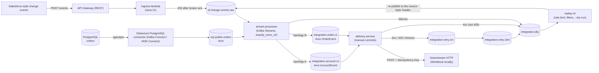

# msk-event-integration

[](https://github.com/i1ich/msk-event-integration/actions/workflows/ci.yml)   

A public reference event-driven integration platform for AWS, built local-first. Salesforce-style change events (HTTP) and row-level changes from a PostgreSQL `orders` table (Debezium CDC) are ingested into Kafka, normalized into canonical Avro topics by Kafka Streams, and delivered to a downstream HTTP service with retry topics and a dead-letter queue; a replay CLI re-drives failed messages. The point is to show the production concerns, not only the happy path: exactly-once processing inside Kafka, idempotent at-least-once delivery, explicit failure routing, schema evolution, and a cost-guarded AWS deployment. Everything runs locally with one command; the AWS stacks (sa-east-1) are written and lint-clean but not deployed yet.

## Architecture



## Status

| Milestone | Scope | Status |
|---|---|---|
| M1 | Local platform: ingress to `sf.change-events.raw`; CDC to `erp.public.orders`; Avro schemas registered | Done |
| M2 | Processing (Kafka Streams topologies A and B) and error handling (DLQ, retry topics, delivery service, replay-cli) | Done |
| M3 | Tests and CI: Testcontainers, JaCoCo >= 80%, cfn-lint, schema compatibility check | Done (CI green on GitHub) |
| M4 | AWS deploy and teardown (sa-east-1: provisioned MSK, Glue Schema Registry, MSK Connect, ECS Fargate, RDS), cost recorded | Templates and scripts ready, lint-clean. First AWS run blocked by the Free plan (no MSK), torn down cleanly; deploy pending Paid plan. See [cost.md](docs/cost.md) |
| M5 | Documentation and knowledge transfer | Done |

## Quick start

Prerequisites: Docker with Compose, Java 21, Maven 3.9+, bash (Git Bash on Windows). Verified on Docker Desktop for Windows with Git Bash.

```bash
bash scripts/up.sh      # or: make up      - build and start the local stack, register connector and schemas (a few minutes the first time)
bash scripts/demo.sh    # or: make demo    - send sample events, change Postgres rows, show every stage (about a minute)
bash scripts/down.sh    # or: make down    - stop the stack and remove volumes
mvn -B verify           # build, unit tests, JaCoCo 80% line-coverage gate
mvn -B verify -Pit      # plus end-to-end tests with Testcontainers (needs Docker, ~4 min)
```

`scripts/demo.sh` needs `replay-cli/target/replay-cli.jar` for its last step (`mvn -B -q -pl replay-cli -am package -DskipTests`). It shows, in order: raw events and CDC events, the canonical `integration.account.v1` / `integration.order.v1` topics, the DLQ with error headers (an unmapped `Opportunity` event and a downstream `400`), what the WireMock downstream received (the flaky account gets `503` first and `200` after `integration.retry.1m`), and a `replay-cli --dry-run`. Locally the retry delays are 5 s / 15 s instead of 1 min / 10 min (see `docker-compose.yml`).

Local endpoints: Kafka `localhost:9092`, Schema Registry `8081`, Kafka Connect `8083`, PostgreSQL `5433` (host; `POSTGRES_HOST_PORT`), ingress `8088` (host; `INGRESS_HOST_PORT`), WireMock `8089`, Kafka UI `8090` (`docker compose --profile ui up -d kafka-ui`).

Sample events are in [`samples/`](samples/README.md).

## 5-minute demo

[`docs/demo-script.md`](docs/demo-script.md) is a timed live-demo script (commands, what to point at, likely questions).

## Tests and CI

| Level | What | Where |
|---|---|---|
| Unit | Mappers, validation, HMAC, error classification, retry routing, replay filters and rate limiter, schema evolution (Avro rules) | `*/src/test`, `mvn -B verify` |
| Topology | Both Kafka Streams topologies with `TopologyTestDriver` and a mock Schema Registry | `stream-processor/src/test` |
| End-to-end | Real Kafka, Schema Registry, PostgreSQL + Debezium Connect (Testcontainers), services in-process, WireMock downstream: ingress → downstream, CDC insert/update/delete, poison messages → DLQ, 503 → retry → success, 400 → DLQ, replay | `integration-tests`, `mvn -B verify -Pit` |
| Schema compatibility | The registry accepts AccountEvent v2 and rejects an incompatible change (HTTP 409) | `SchemaRegistryCompatibilityIT`, `scripts/check-schema-compat.sh` |

Coverage gate: JaCoCo fails the build below 80% line coverage per module. Avro-generated classes and the `*App` wiring classes are excluded; the end-to-end tests cover the wiring.

The services run with `SCHEMA_AUTO_REGISTER=false` in the end-to-end tests, as in production. They write with the latest registered schema version and never register schemas themselves.

`.github/workflows/ci.yml` runs on every push and pull request. Jobs:

- unit tests with the coverage gate (report as artifact and summary, badge committed on `main`);
- end-to-end tests (`-Pit`);
- `cfn-lint` 1.20.2 on every template in `infra/cloudformation`;
- the schema compatibility test;
- a Trivy dependency scan (HIGH/CRITICAL with a fix available fail the build).

`.github/workflows/deploy.yml` is a manual workflow (`workflow_dispatch`: deploy, smoke, teardown) that authenticates to AWS with GitHub OIDC. It has not been run yet.

## Topics

| Topic | Key | Format | Producer | Notes |
|---|---|---|---|---|
| `sf.change-events.raw` | first `recordIds` entry (Salesforce record Id) | JSON exactly as received; headers `event-id`, `received-at`, `source`, `transaction-key` | ingress-lambda; replay-cli (replays) | Input to topology A. Written only after broker ack. |
| `erp.public.orders` | `orders` primary key | Avro (Debezium envelope) | Debezium `orders-source` connector | Input to topology B. Ordered per key. |
| `integration.account.v1` | account id | Avro `AccountEvent` (`schemas/account/AccountEvent.v2.avsc` is current) | stream-processor (topology A) | Canonical. Consumed by delivery-service. |
| `integration.order.v1` | order id | Avro `OrderEvent` (`schemas/order/OrderEvent.v1.avsc`) | stream-processor (topology B) | Canonical. Consumed by delivery-service. |
| `integration.retry.1m` | original key | Avro canonical payload plus retry headers | delivery-service | First retry hop, about 1 minute. |
| `integration.retry.10m` | original key | Avro canonical payload plus retry headers | delivery-service | Second retry hop, about 10 minutes. Then DLQ. |
| `integration.dlq` | original key | Original payload plus error headers (see [architecture](docs/architecture.md)) | stream-processor, delivery-service | Terminal. Re-driven with replay-cli. Retention 14 days. |

All topics have 3 partitions (`scripts/topics.txt`); retention is 7 days except the DLQ.

## Versions

Checked against the root `pom.xml`, `docker-compose.yml`, `infra/connect/Dockerfile` and `infra/cloudformation/msk.yaml`.

| Component | Version |
|---|---|
| Java | 21 |
| kafka-clients / kafka-streams | 3.9.2 |
| Apache Avro | 1.12.0 |
| Confluent serdes (`kafka-avro-serializer` family) | 7.9.0 |
| aws-msk-iam-auth | 2.2.0 |
| AWS Glue Schema Registry serde / Connect converter | 1.1.27 |
| Jackson | 2.18.12 |
| lz4-java (pinned transitive) | 1.8.1, relocated to `at.yawk.lz4:lz4-java` 1.11.4 |
| snappy-java (pinned transitive) | 1.1.10.12 |
| picocli (replay-cli) | 4.7.6 |
| JUnit 5 | 5.11.4 |
| Testcontainers | 1.20.4 |
| WireMock (library in tests) / image | 3.10.0 / `wiremock/wiremock:3.10.0` |
| Confluent Kafka (cp-kafka, KRaft) | 7.9.0 |
| Confluent Schema Registry (cp-schema-registry) | 7.9.0 |
| Confluent Kafka Connect (cp-kafka-connect) | 7.9.0 |
| Debezium PostgreSQL connector | 2.5.4 (`2.5.4.Final` in the MSK Connect plugin) |
| PostgreSQL | 16 (`postgres:16`; RDS PostgreSQL 16 on AWS) |
| Kafka UI | `provectuslabs/kafka-ui:v0.7.2` |
| Amazon MSK Kafka version (default) | `3.9.x` |
| cfn-lint (CI) | 1.20.2 |

## AWS deployment

Region `sa-east-1` (Sao Paulo). MSK Serverless is not available there, so the default is a provisioned cluster (2 x `kafka.t3.small`, [ADR 0006](docs/adr/0006-msk-provisioned-in-sa-east-1.md)). Templates are plain CloudFormation in [`infra/cloudformation/`](infra/cloudformation/README.md); names, exports and IAM rules are fixed in [`CONTRACT.md`](infra/cloudformation/CONTRACT.md). Stacks are named `<env>-msk-ei-<stack>`:

`artifacts`, `network` (one NAT gateway, [ADR 0005](docs/adr/0005-nat-vs-vpc-endpoints.md)), `msk`, `topics` (custom resource), `schema-registry` (Glue), `database` (RDS PostgreSQL 16), `ecr`, `msk-connect` (Debezium), `ingress` (API Gateway + Lambda), `processing` (ECS Fargate: stream-processor, delivery-service with a WireMock sidecar), `observability` (dashboard, alarms). Account-level and kept by teardown: `msk-ei-budget` and the optional `github-oidc`.

Cost: about 0.55 USD per hour while everything runs, about 1.7 USD for one demo run (deploy, demo, teardown in roughly 3 hours), about 13 USD per day if teardown is forgotten. Details and unit prices in [`docs/cost.md`](docs/cost.md). Guardrails: create the budgets first, deploy and tear down on the same day, check for leftovers.

```bash
bash scripts/create-budget.sh you@example.com   # once per account: 15 USD/month and 3 USD/day budgets (optional args: monthly, daily)
bash scripts/deploy.sh dev                      # asks for confirmation after the cost warning
bash scripts/smoke-test.sh dev                  # optional: ingress -> MSK -> streams -> delivery, and CDC
bash scripts/teardown.sh dev                    # deletes everything, then runs check-leftovers
bash scripts/check-leftovers.sh dev             # lists anything billable that is still there (exit 1 if found)
```

Runbooks: [deploy](docs/runbooks/deploy.md), [teardown](docs/runbooks/teardown.md).

Status, honestly: the first AWS run (2026-10-28) deployed `artifacts` and `network`, then stopped at `msk`: the account is on the AWS Free plan, which does not include Amazon MSK. It was torn down and checked for leftovers (about 0.02 USD). The full deploy, the IAM authentication to MSK ([ADR 0004](docs/adr/0004-iam-auth.md)), the Glue path and MSK Connect are therefore not yet exercised on AWS; the deploy is pending an upgrade to the Paid plan. The local platform and the end-to-end tests cover the same code with plaintext Kafka and the Confluent registry.

## Design decisions

Each decision has a record in [`docs/adr/`](docs/adr/README.md):

- [ADR 0001: Kafka Streams instead of Lambda for stream processing](docs/adr/0001-kafka-streams-vs-lambda.md)
- [ADR 0002: AWS Glue Schema Registry on AWS, Confluent Schema Registry locally](docs/adr/0002-glue-vs-confluent-sr.md)
- [ADR 0003: Retry topics instead of in-process or single-topic retry](docs/adr/0003-retry-topics.md)
- [ADR 0004: IAM authentication to MSK](docs/adr/0004-iam-auth.md)
- [ADR 0005: One NAT gateway instead of interface VPC endpoints](docs/adr/0005-nat-vs-vpc-endpoints.md)
- [ADR 0006: MSK provisioned cluster in sa-east-1](docs/adr/0006-msk-provisioned-in-sa-east-1.md)

## Documentation map

| Document | What it is |
|---|---|
| [docs/architecture.md](docs/architecture.md) | Components, ordering, delivery semantics, DLQ header contract, AWS layout |
| [docs/knowledge-transfer.md](docs/knowledge-transfer.md) | What runs where, how to redeploy and operate, incident triage |
| [docs/talking-points.md](docs/talking-points.md) | Interview talking points and trade-offs |
| [docs/demo-script.md](docs/demo-script.md) | 5-minute live demo |
| [docs/runbooks/](docs/runbooks/README.md) | DLQ replay, connector restart and slot lag, schema evolution, deploy, teardown |
| [docs/cost.md](docs/cost.md) | Prices, estimates, guardrails, session log |
| [infra/cloudformation/CONTRACT.md](infra/cloudformation/CONTRACT.md) | Binding AWS contract: stacks, exports, IAM, configuration |
| Module READMEs | [ingress-lambda](ingress-lambda/README.md), [stream-processor](stream-processor/README.md), [delivery-service](delivery-service/README.md), [replay-cli](replay-cli/README.md), [infra-bootstrap](infra-bootstrap/README.md), [integration-tests](integration-tests/README.md), [infra/connect](infra/connect/README.md), [infra/wiremock](infra/wiremock/README.md), [samples](samples/README.md) |

## Repository layout

```text
msk-event-integration/
├── pom.xml                  # Maven parent (multi-module)
├── common/                  # shared config, Avro generated types, DLQ helpers, utilities
├── ingress-lambda/          # POST /events: validate, optional HMAC, produce to the raw topic
├── stream-processor/        # Kafka Streams topologies A (account) and B (order), DLQ routing
├── delivery-service/        # consume canonical topics, deliver over HTTP, retry hops
├── replay-cli/              # re-drive DLQ messages to the source topic
├── infra-bootstrap/         # Lambdas used as CloudFormation custom resources (Kafka topics, DB init)
├── integration-tests/       # Testcontainers end-to-end tests (-Pit)
├── schemas/                 # Avro schemas (account/, order/, test-fixtures/)
├── samples/                 # sample events for the demo
├── infra/
│   ├── cloudformation/      # AWS stacks and CONTRACT.md
│   ├── connect/             # Debezium connector config, local Connect image, plugin build (plugin/)
│   ├── postgres/init/       # table, publication, seed rows
│   └── wiremock/            # downstream mock: mappings and image
├── scripts/                 # up/down/demo, schema registration, deploy/teardown, budget, leftovers check
├── docs/                    # architecture, ADRs, runbooks, cost, demo script, knowledge transfer
├── docker-compose.yml       # local stack
├── Makefile                 # shortcuts for the scripts
└── .github/                 # CI and deploy workflows, coverage badge
```

## License

MIT. See [LICENSE](LICENSE).
