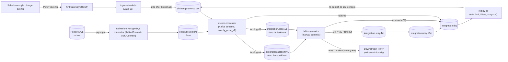

# msk-event-integration

A public reference event-driven integration platform on AWS. Change events from a Salesforce-style source and row-level changes from a PostgreSQL `orders` table are ingested, normalized into canonical Avro topics with Kafka Streams, and delivered to a downstream HTTP service with retries and a dead-letter queue. A replay CLI re-drives failed messages. Built as an honest portfolio project: local-first, with the AWS deployment added in a later milestone.

## Architecture



## Status

| Milestone | Scope | Status |
|---|---|---|
| M1 | Local platform: ingress to `sf.change-events.raw`; CDC to `erp.public.orders`; Avro schemas registered | Done |
| M2 | Processing (Kafka Streams topologies A and B) and error handling (DLQ, retry topics, delivery service, replay-cli) | Done (pending review) |
| M3 | Tests and CI: Testcontainers, JaCoCo >= 80%, cfn-lint, schema compatibility check | Planned |
| M4 | AWS deploy and teardown (MSK, Glue Schema Registry, ECS Fargate, RDS), cost recorded | Planned |
| M5 | Documentation and knowledge transfer | Planned |

## Quick start

Prerequisites: Docker with Compose, Java 21, Maven 3.9+, bash.

M1 and M2 run end to end locally (verified on Docker Desktop for Windows with Git Bash).

The demo posts the samples in `samples/` and changes rows in Postgres. It then shows, in order:

1. Raw events and CDC events.
2. Canonical `integration.account.v1` / `integration.order.v1`.
3. The DLQ with error headers: an unmapped `Opportunity` event and a downstream `400`.
4. What the WireMock downstream received: the flaky account gets `503` first and `200` after `integration.retry.1m`.
5. A `replay-cli --dry-run`.

Locally the retry delays are 5 s / 15 s instead of 1 min / 10 min (see `docker-compose.yml`), so the demo takes about a minute.

```bash
bash scripts/up.sh      # or: make up      - start the local stack
bash scripts/demo.sh    # or: make demo    - send sample events and show results
bash scripts/down.sh    # stop the stack and remove volumes
mvn -B verify           # build and run tests
```

Local endpoints: Kafka `localhost:9092`, Schema Registry `8081`, Kafka Connect `8083`, PostgreSQL `5433` (host; `POSTGRES_HOST_PORT`), ingress `8088` (host; `INGRESS_HOST_PORT`), WireMock `8089`, Kafka UI `8090`.

## Topics

| Topic | Key | Format | Producer | Notes |
|---|---|---|---|---|
| `sf.change-events.raw` | first `recordIds` entry (Salesforce record Id) | JSON exactly as received; headers `event-id`, `received-at`, `source`, `transaction-key` | ingress-lambda; replay-cli (replays) | Input to topology A. Written only after broker ack. |
| `erp.public.orders` | `orders` primary key | Avro (Debezium envelope), `schemas/order/` | Debezium `orders-source` connector | Input to topology B. Ordered per key. |
| `integration.account.v1` | account id | Avro `AccountEvent` (`schemas/account/AccountEvent.v2.avsc` is current) | stream-processor (topology A) | Canonical. Consumed by delivery-service. |
| `integration.order.v1` | order id | Avro `OrderEvent` (`schemas/order/OrderEvent.v1.avsc`) | stream-processor (topology B) | Canonical. Consumed by delivery-service. |
| `integration.retry.1m` | original key | Avro canonical payload plus retry headers | delivery-service | First retry hop, about 1 minute. |
| `integration.retry.10m` | original key | Avro canonical payload plus retry headers | delivery-service | Second retry hop, about 10 minutes. Then DLQ. |
| `integration.dlq` | original key | Original payload plus error headers (see [architecture](docs/architecture.md#dlq-header-contract)) | stream-processor, delivery-service | Terminal. Re-driven with replay-cli. |

## Versions

| Component | Version |
|---|---|
| Java | 21 |
| kafka-clients / kafka-streams | 3.9.1 |
| Apache Avro | 1.12.0 |
| Confluent serdes (`kafka-avro-serializer` family) | 7.9.0 |
| aws-msk-iam-auth | 2.2.0 |
| Jackson | 2.18.2 |
| picocli (replay-cli) | 4.7.6 |
| JUnit 5 | 5.11.4 |
| Testcontainers | 1.20.4 |
| Confluent Kafka (cp-kafka, KRaft) | 7.9.0 |
| Confluent Schema Registry (cp-schema-registry) | 7.9.0 |
| Confluent Kafka Connect (cp-kafka-connect) | 7.9.0 |
| Debezium PostgreSQL connector | 2.5.4 |
| PostgreSQL | 16 (`postgres:16`) |
| WireMock | 3.10.0 |
| Kafka UI | v0.7.2 |

## Design decisions

Each decision has a record in [`docs/adr/`](docs/adr/):

- [ADR 0001: Kafka Streams instead of Lambda for stream processing](docs/adr/0001-kafka-streams-vs-lambda.md)
- [ADR 0002: AWS Glue Schema Registry on AWS, Confluent Schema Registry locally](docs/adr/0002-glue-vs-confluent-sr.md)
- [ADR 0003: Retry topics instead of in-process or single-topic retry](docs/adr/0003-retry-topics.md)
- [ADR 0004: IAM authentication to MSK](docs/adr/0004-iam-auth.md)

Other documents: [architecture and delivery semantics](docs/architecture.md), [cost guardrails](docs/cost.md), [knowledge transfer](docs/knowledge-transfer.md), [runbooks](docs/runbooks/).

## Repository layout

```text
msk-event-integration/
├── pom.xml                  # Maven parent (multi-module)
├── common/                  # shared config, Avro generated types, utilities
├── ingress-lambda/          # POST /events: validate, optional HMAC, produce to raw topic
├── stream-processor/        # Kafka Streams topologies A (account) and B (order), DLQ routing
├── delivery-service/        # consume canonical topics, deliver over HTTP, retry hops
├── replay-cli/              # re-drive DLQ messages to the source topic
├── schemas/                 # Avro schemas (account/, order/)
├── samples/                 # sample events and payloads for demo
├── infra/                   # CloudFormation stacks (network, msk, topics, schema-registry, msk-connect, ingress, processing, observability)
├── scripts/                 # up.sh, demo.sh, down.sh (local docker compose)
├── docs/                    # architecture, ADRs, runbooks, cost, knowledge transfer
└── .github/                 # CI workflows (M3)
```

## License

MIT. See [LICENSE](LICENSE).
