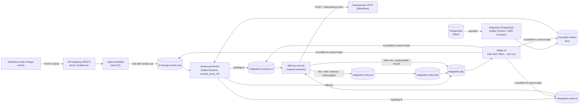

# Architecture

Status: M1-M3 implemented and tested locally. M4 (AWS) templates and scripts are written and `cfn-lint` clean but not yet deployed: the first run stopped at the `msk` stack because the account is on the AWS Free plan, which does not include Amazon MSK (see [cost.md](cost.md#session-log)). Everything described under "AWS" below is therefore design, not measured behavior. Pending: AWS run (needs Paid plan).

## Overview

Two sources feed Kafka: Salesforce-style change events over HTTP, and row changes of a PostgreSQL `orders` table captured by Debezium. A Kafka Streams application normalizes both into canonical Avro topics. A delivery service POSTs the canonical events to a downstream HTTP API, with a retry ladder and a dead-letter queue (DLQ). A CLI re-drives DLQ records.

The code path is the same locally and on AWS. Only hosting, authentication and the schema registry differ, selected by environment variables.

| Aspect | Local (docker compose) | AWS (CloudFormation, not yet deployed) |
|---|---|---|
| Ingress | `LocalServer` (JDK HTTP server) in a container, host port 8088 | API Gateway REST + Lambda in private subnets |
| Kafka | 1 broker, KRaft, plaintext, RF 1 | MSK provisioned, 2 x `kafka.t3.small`, IAM + TLS, RF 2, min ISR 1 (region sa-east-1 has no MSK Serverless) |
| Schema registry | Confluent (`SCHEMA_REGISTRY_TYPE=confluent`, port 8081) | AWS Glue Schema Registry (`glue`) |
| Debezium | Kafka Connect container, Confluent Avro converter for key and value | MSK Connect, JSON key converter, Glue Avro converter for the value |
| PostgreSQL | `postgres:16` container, host port 5433 | RDS PostgreSQL 16 `db.t4g.micro` |
| stream-processor, delivery-service | Containers | ECS Fargate (delivery task has a WireMock sidecar as downstream) |
| Retry delays | 5 s / 15 s (compose env) | 1 min / 10 min (defaults) |
| Monitoring | Kafka UI (port 8090, profile `ui`), container logs | CloudWatch dashboard, alarms, SNS email |
| AWS API egress | n/a | One NAT gateway (ADR 0005) |

Full AWS contract: [infra/cloudformation/CONTRACT.md](../infra/cloudformation/CONTRACT.md). Decisions: [ADRs](adr/).

## Components

### ingress-lambda

Code: [`EventIngestService`](../ingress-lambda/src/main/java/io/github/i1ich/mskei/ingress/EventIngestService.java), [`IngressHandler`](../ingress-lambda/src/main/java/io/github/i1ich/mskei/ingress/IngressHandler.java), [`LocalServer`](../ingress-lambda/src/main/java/io/github/i1ich/mskei/ingress/local/LocalServer.java).

**How it works.** `EventIngestService` holds all logic; the Lambda handler and the local server are thin adapters. In order, the first failure stops the request and nothing is published: body larger than `INGRESS_MAX_BODY_BYTES` (default 262144) gives 413; if an HMAC secret is configured, `X-Signature: sha256=<hex>` must match HMAC-SHA256 of the raw body (401 otherwise); malformed JSON gives 400 `malformed_json`; `ChangeEventHeader` must have `entityName`, `changeType` (CREATE, UPDATE, DELETE, UNDELETE), non-empty `recordIds` and numeric `commitTimestamp` (400 `validation_failed`, all problems listed). The record is then published to `sf.change-events.raw` with the raw body as value and the first `recordIds` entry as key. The call waits up to 10 s for the broker ack and answers 202 with `eventId`, topic, partition and offset; a broker error or timeout gives 503 `broker_unavailable`. The producer uses `enable.idempotence=true`, `acks=all`, `delivery.timeout.ms=10000`, `linger.ms=0`. On AWS the Kafka producer and the HMAC secret (Secrets Manager, `INGRESS_HMAC_SECRET_ARN`) are created once per Lambda container in a static holder.

**What can go wrong.**
- Broker unavailable: 503, the client must retry. Nothing is acknowledged that was not stored.
- Client retries after a lost response: the event is published twice. The idempotent producer only removes duplicates from the producer's own internal retries. The `event-id` header is `ChangeEventHeader.eventId` if the client sends one, otherwise a new random UUID, so only clients that send a stable `eventId` get deduplication downstream.
- No HMAC secret configured: requests are accepted without a signature. The check is on whenever a secret is set. If `INGRESS_HMAC_SECRET_ARN` is set but the secret is empty, startup fails.
- Cold start (AWS): JVM start, producer creation and broker connection happen on the first request after a new container. SnapStart is a template parameter, default off. Not measured yet.
- Multi-record events: the key is only the first record id, so ordering on the raw topic is per first id.

### PostgreSQL and Debezium

Config: [`infra/connect/orders-source.local.json`](../infra/connect/orders-source.local.json), [`infra/connect/orders-source.msk-connect.json`](../infra/connect/orders-source.msk-connect.json) (reference only; the real AWS source is `msk-connect.yaml`), [`01-schema.sql`](../infra/postgres/init/01-schema.sql).

**How it works.** The `orders` table has `REPLICA IDENTITY FULL` and a publication `dbz_orders_pub` created by the init script. The Debezium PostgreSQL connector `orders-source` reads it with `pgoutput` through the fixed replication slot `dbz_orders_slot` (`publication.autocreate.mode=disabled`, `snapshot.mode=initial`, `tombstones.on.delete=true`, `decimal.handling.mode=string`) and writes Avro envelopes to `erp.public.orders`. The envelope schema is registered by the converter, not from `schemas/`. Locally key and value use the Confluent Avro converter. On AWS the key is JSON (`JsonConverter`, schemas disabled) and the value uses the Glue `AWSKafkaAvroConverter` with auto-registration on and compatibility `BACKWARD`.

**What can go wrong.**
- Connector stopped or failing: the slot retains WAL and RDS disk grows. See [connector restart and slot lag](runbooks/connector-restart-and-slot-lag.md). The environment has no alarm on slot lag or connector state yet (see [Observability](#observability)).
- Slot dropped: unconsumed changes are lost and the connector must re-snapshot.
- Table change without a matching mapper change: the envelope still serializes, but `OrderMapper` reads fixed columns (`id`, `account_id`, `status`, `amount`, `currency`, `updated_at`); missing or renamed columns end up as null fields or DLQ records. See [schema evolution](runbooks/schema-evolution.md).
- The connector password is a CloudFormation dynamic reference, so it is visible to anyone who can describe the connector (demo trade-off).

### stream-processor (Kafka Streams)

Code: [`ProcessorTopology`](../stream-processor/src/main/java/io/github/i1ich/mskei/processor/ProcessorTopology.java), [`SafeMapProcessor`](../stream-processor/src/main/java/io/github/i1ich/mskei/processor/SafeMapProcessor.java), [`AccountMapper`](../stream-processor/src/main/java/io/github/i1ich/mskei/processor/AccountMapper.java), [`OrderMapper`](../stream-processor/src/main/java/io/github/i1ich/mskei/processor/OrderMapper.java), [`DlqDeserializationExceptionHandler`](../stream-processor/src/main/java/io/github/i1ich/mskei/processor/DlqDeserializationExceptionHandler.java), [`StreamProcessorApp`](../stream-processor/src/main/java/io/github/i1ich/mskei/processor/StreamProcessorApp.java).

**How it works.** One application (`application.id` `stream-processor`, one topology object, one transaction scope) with `processing.guarantee=exactly_once_v2` and two sub-topologies:
- Topology A: `sf.change-events.raw` (String key, raw bytes) to `integration.account.v1` (`AccountEvent`, key = account id). Only entity `Account` is mapped; any other entity raises `UnmappedEntityException`. A Salesforce event with several `recordIds` becomes one `AccountEvent` per id; `eventId` is the `event-id` header (fallback `<topic>-<partition>-<offset>`), with suffix `-<index>` when there is more than one id.
- Topology B: `erp.public.orders` (raw key and value bytes) to `integration.order.v1` (`OrderEvent`, key = order id as text). `op` c/u/r/d maps to CREATE/UPDATE/SNAPSHOT/DELETE; a delete reads the `before` image. `eventId` is `erp.public.orders-<orderId>-<lsn>-<op>` (WAL position; fallback `erp.public.orders-<partition>-<offset>` if the envelope has no LSN). Tombstones (null value) are skipped.

Both sources are read as raw bytes. `SafeMapProcessor` (Processor API) runs the mapper inside a try/catch and forwards either the mapped event or a ready-made dead-letter record; `split()` sends the latter to `integration.dlq`. Because the DLQ write is just another output of the topology, it is part of the same transaction as normal output. Output records keep the input headers; DLQ records get the DLQ headers (see [Headers contract](#headers-contract)) with `attempts=1`. Stream-thread crashes are handled with `REPLACE_THREAD`.

**What can go wrong.**
- Poison message (bad JSON, unknown entity, unknown `op`, undecodable Avro): goes to the DLQ, the app keeps running. Covered by `PoisonMessagesIT`.
- Failures before the processor (Streams-level deserialization): `DlqDeserializationExceptionHandler` writes to the DLQ with its own idempotent, non-transactional producer, then continues. Both sources are raw bytes today, so this should not fire; if it does, a crash can leave a duplicate DLQ record, and if the DLQ write itself fails the stream thread fails.
- Serialization to the output topics needs the schema in the registry. With `SCHEMA_AUTO_REGISTER=false` and a missing schema the thread is replaced and fails again until the schemas are registered.
- Rebalance or restart: an in-flight transaction is aborted and redone. Consumers that read uncommitted data can see records of aborted transactions (see delivery semantics).
- More tasks than partitions sit idle: every topic has 3 partitions.

### delivery-service

Code: [`DeliveryServiceApp`](../delivery-service/src/main/java/io/github/i1ich/mskei/delivery/DeliveryServiceApp.java), [`ConsumerLoop`](../delivery-service/src/main/java/io/github/i1ich/mskei/delivery/ConsumerLoop.java), [`RecordHandler`](../delivery-service/src/main/java/io/github/i1ich/mskei/delivery/RecordHandler.java), [`Classifier`](../delivery-service/src/main/java/io/github/i1ich/mskei/delivery/Classifier.java), [`RetryRouter`](../delivery-service/src/main/java/io/github/i1ich/mskei/delivery/RetryRouter.java), [`NotBefore`](../delivery-service/src/main/java/io/github/i1ich/mskei/delivery/NotBefore.java), [`DeliveryConfig`](../delivery-service/src/main/java/io/github/i1ich/mskei/delivery/DeliveryConfig.java).

**How it works.** Two consumer threads in one process, each with its own consumer: `delivery-service` (canonical topics) and `delivery-service-retry` (`integration.retry.1m`, `integration.retry.10m`). Auto-commit is off; `max.poll.records=50`. For each record the Avro value is decoded and sent as JSON to `POST {DOWNSTREAM_URL}/accounts` or `/orders` (chosen by the original topic) with `Idempotency-Key: <eventId>`. Classification:
- 2xx: success.
- 429, 5xx, `IOException` (timeout, connection error): retryable.
- other 4xx, undecodable record, unknown topic, any other exception: permanent, straight to the DLQ.

Retry ladder, three attempts in total:

| Attempt | Read from | On retryable failure |
|---|---|---|
| 1 | `integration.account.v1` / `integration.order.v1` | write to `integration.retry.1m` |
| 2 | `integration.retry.1m` | write to `integration.retry.10m` |
| 3 | `integration.retry.10m` | write to `integration.dlq` |

A retry record has the same key and the original value bytes, the original headers, plus `source-topic` (the canonical topic), `attempts` and `not-before` (now + configured delay). The retry consumer honors `not-before`: if the head record of a partition is not due, it seeks back, pauses the partition and keeps polling so it stays in the group. This head-of-line blocking is correct because all records in one retry topic have the same delay. After handling a batch the loop waits for every retry/DLQ write to be acknowledged (idempotent producer, `acks=all`) and then commits offsets synchronously. If a Kafka write fails, the thread throws and the process exits with code 1 for the orchestrator to restart.

**What can go wrong.**
- Crash after the HTTP call and before the commit: the event is delivered again. The downstream must honor `Idempotency-Key`; this is a contract with the downstream, not enforced here.
- Retries reorder events for a key (see [Ordering](#ordering-per-key)).
- Downstream outage: every event walks the ladder (about 11 minutes with default delays) and then lands in the DLQ. Replay after recovery.
- Slow downstream: a batch is up to 50 records with a 5 s request timeout each, which can approach `max.poll.interval.ms` (Kafka default 5 min; not overridden) during a brownout.
- The delivery consumers use `isolation.level=read_committed`, so they never see records of aborted stream-processor transactions. See delivery semantics.

### replay-cli

Code: [`ReplayCli`](../replay-cli/src/main/java/io/github/i1ich/mskei/replay/ReplayCli.java), [`DlqReplayer`](../replay-cli/src/main/java/io/github/i1ich/mskei/replay/DlqReplayer.java), [`ReplayFilter`](../replay-cli/src/main/java/io/github/i1ich/mskei/replay/ReplayFilter.java), [`RateLimiter`](../replay-cli/src/main/java/io/github/i1ich/mskei/replay/RateLimiter.java).

**How it works.** Reads the whole `integration.dlq` once with `assign()` and `seekToBeginning` (no consumer group, nothing committed) up to the end offsets captured at start, so records that fail again during the run are not replayed in a loop. Filters: `--source-topic`, `--error-class` (full or simple name), `--from` (inclusive) / `--to` (exclusive) on `failed-at`. Each match is produced to the topic in its `source-topic` header with the same key and value bytes and all headers except the DLQ and retry headers, plus `replayed-at`. `--rate` (default 10 msg/s), `--max`, `--dry-run`. The producer is idempotent with `acks=all`. Exit codes: 0 ok, 1 runtime error or failed sends, 2 bad arguments.

**What can go wrong.**
- The DLQ is not modified, so running the same replay twice sends the records twice.
- Replaying without fixing the cause: the record fails again and a new DLQ record appears.
- Replayed records are appended at the end of their partition; original order is not restored.
- A replayed CDC record is a new record in `erp.public.orders` at a new offset, but its `eventId` comes from the WAL position (`erp.public.orders-<orderId>-<lsn>-<op>`), so the downstream sees the same `Idempotency-Key`. Replays of delivery failures go to the canonical topic with the unchanged Avro `eventId`, so the key stays the same too. replay-cli reads the DLQ with `read_committed`.
- Records without a `source-topic` header are skipped and counted; records without a parsable `failed-at` never match when `--from`/`--to` is used.
- Without `--dry-run`, a wrong filter republishes a large set. Always dry-run first. Runbook: [DLQ replay](runbooks/dlq-replay.md).

### Schema registry switch (Confluent / Glue)

Code: [`SchemaRegistryConfig`](../common/src/main/java/io/github/i1ich/mskei/common/SchemaRegistryConfig.java), [`AvroSerdes`](../common/src/main/java/io/github/i1ich/mskei/common/AvroSerdes.java), [`GeneratedSchemas`](../common/src/main/java/io/github/i1ich/mskei/common/GeneratedSchemas.java). Decision: [ADR 0002](adr/0002-glue-vs-confluent-sr.md).

**How it works.** `SCHEMA_REGISTRY_TYPE` is `confluent` (default; needs `SCHEMA_REGISTRY_URL`) or `glue` (needs `GLUE_REGISTRY_NAME` and `AWS_REGION`; credentials from the default provider chain). `AvroSerdes` hides the choice: a value serializer for specific records, a generic-record deserializer (Debezium envelopes, delivery JSON) and a Streams serde. Schema name equals topic name on Glue; on Confluent the subject is `<topic>-value`. Compatibility is `BACKWARD` in both. The choice is per deployment, never per topic.

**What can go wrong.**
- Wire formats are incompatible. Confluent writes a magic byte plus a 4-byte schema id; Glue writes a header byte, a compression byte and a 16-byte schema version UUID. A record written with one cannot be read with the other. Data written locally does not carry over to AWS.
- `avro.java.string`: the generated classes carry `"avro.java.string":"String"` (from `stringType=String`), so their schema text differs from the `.avsc` files. With auto-registration off, Confluent lookups by text fail with 40403. Fix: with `SCHEMA_AUTO_REGISTER=false` the Confluent config sets `use.latest.version=true`, so the serializer writes with the latest registered version and still checks compatibility with the record's own schema. The end-to-end tests caught this.
- Glue has no "use latest version" option: its serializer finds a schema by exact definition. `GeneratedSchemas` prints the schema text of the generated class per topic, and `scripts/register-schemas-glue.sh` registers that text as the newest version after the `.avsc` versions. It is semantically the same schema (checked by `GeneratedSchemasTest`) and the `BACKWARD` check still applies.
- Verification status: the Confluent path is covered by unit and end-to-end tests. The Glue path (serde, registration script, MSK Connect converter) is unit-tested for configuration only and has never run against AWS.
- Kafka UI and Confluent console tools cannot decode Glue records.
- The compatibility CI check (`scripts/check-schema-compat.sh`) runs against the local Confluent registry only.

### Ingress is not schema-registered

`sf.change-events.raw` carries raw JSON. Only the CDC topic and the three canonical/CDC schemas use a registry.

## Topics

From [`scripts/topics.txt`](../scripts/topics.txt) (docker `kafka-init` locally, `TopicsHandler` on AWS). All have 3 partitions. Replication factor is 1 locally and the broker default (2) on AWS.

| Topic | Key | Value format | Producer | Retention |
|---|---|---|---|---|
| `sf.change-events.raw` | first `recordIds` entry (String) | JSON as received | ingress-lambda; replay-cli | 7 days |
| `erp.public.orders` | order primary key (Avro locally, JSON on AWS) | Avro Debezium envelope | Debezium | 7 days |
| `integration.account.v1` | account id (String) | Avro `AccountEvent` (v2 is current) | stream-processor | 7 days |
| `integration.order.v1` | order id as text (String) | Avro `OrderEvent` | stream-processor | 7 days |
| `integration.retry.1m` | original key bytes | original canonical Avro bytes | delivery-service | 7 days |
| `integration.retry.10m` | original key bytes | original canonical Avro bytes | delivery-service | 7 days |
| `integration.dlq` | original key bytes | original value bytes | stream-processor, delivery-service | 14 days |

## Headers contract

All header values are UTF-8 text. Names are constants in [`EventHeaders`](../common/src/main/java/io/github/i1ich/mskei/common/EventHeaders.java); DLQ records are built only by [`DeadLetters.record`](../common/src/main/java/io/github/i1ich/mskei/common/DeadLetters.java).

Raw headers, set by ingress on `sf.change-events.raw`:

| Header | Value |
|---|---|
| `event-id` | `ChangeEventHeader.eventId` if present, else a random UUID |
| `received-at` | ISO-8601 instant of receipt |
| `source` | `salesforce` |
| `transaction-key` | `ChangeEventHeader.transactionKey`, only if present |

Canonical records keep the headers of their input record. Retry records add `source-topic`, `attempts`, `not-before`.

DLQ headers (the original headers are kept, except those listed here, which are replaced with fresh values so that only the latest failure is described):

| Header | Value |
|---|---|
| `error-class` | Fully qualified exception class name |
| `error-message` | Exception message, truncated to 1000 characters (`"null"` if there is none) |
| `source-topic` | Topic to republish to |
| `source-partition` | Partition of the failed record, decimal |
| `source-offset` | Offset of the failed record, decimal |
| `failed-at` | ISO-8601 UTC instant of the failure |
| `attempts` | Decimal count, see below |

The DLQ record never carries `not-before`. replay-cli removes all of the above plus `not-before` and adds `replayed-at` (ISO-8601 instant). `event-id` and other original headers stay.

`attempts` semantics:

| Where the record failed | Header on the record written | `attempts` | `source-topic` |
|---|---|---|---|
| stream-processor (any failure) | DLQ | 1 | raw or CDC topic |
| delivery, attempt 1 (canonical topic), retryable | `retry.1m` | 1 (failed attempts so far) | canonical topic |
| delivery, attempt 2 (`retry.1m`), retryable | `retry.10m` | 2 | canonical topic |
| delivery, attempt 3 (`retry.10m`), retryable | DLQ | 3 (the attempt that failed) | canonical topic |
| delivery, permanent, from canonical / `retry.1m` / `retry.10m` | DLQ | 1 / 2 / 3 | canonical topic |

Note the two meanings: on a retry record `attempts` counts failed attempts so far; on a DLQ record it is the number of the attempt that failed. After a retry, `source-partition` and `source-offset` of a DLQ record point into the retry topic (the place where the last attempt failed), while `source-topic` is always the canonical topic, so replay publishes to the right place. For stream-processor failures all three point at the raw or CDC input record.

## Delivery semantics

| Stage | Guarantee | Notes |
|---|---|---|
| Client to raw topic | At least once from the client's view | Idempotent producer removes duplicates from producer retries only. Client retries can duplicate. |
| Raw/CDC to canonical topics and DLQ | Exactly once inside Kafka (`exactly_once_v2`) | Consume, process, produce and DLQ writes by the topology are one transaction; input offsets commit with it. |
| Streams deserialization failures | At least once | `DlqDeserializationExceptionHandler` uses its own producer outside the transaction. |
| Canonical topics to downstream HTTP | At least once | Manual commit after the outcome is durable. |
| Retry / DLQ writes by delivery-service | No loss, no producer-retry duplicates | Idempotent producer, `acks=all`, offsets committed only after the ack. A crash before the commit can still write the record again. |

- **Producer safety.** Ingress, delivery-service, replay-cli and the DLQ handler use `enable.idempotence=true` and `acks=all`. On the 2-broker AWS cluster `min.insync.replicas=1`, so an acknowledged write may exist on one replica only (demo trade-off, ADR 0006).
- **`exactly_once_v2` does not cover** the HTTP call to the downstream, the Streams deserialization handler's producer, or consumers that read uncommitted data. delivery-service and replay-cli therefore consume with `isolation.level=read_committed`, so records of an aborted transaction are never delivered or replayed.
- **At-least-once delivery plus `Idempotency-Key`.** The key is the Avro `eventId`. It is deterministic: for CDC `erp.public.orders-<orderId>-<lsn>-<op>` (WAL position, stable across reprocessing and replay); for Salesforce events the `event-id` header (client-supplied `eventId` or a random UUID chosen at ingress, then fixed in the record); for a multi-`recordIds` event `<event-id>-<index>` per record.
- **Not deterministic across re-ingestion.** The same Salesforce event posted twice without a client `eventId` gets two UUIDs and two Idempotency-Keys. A replayed CDC record keeps its WAL-based `eventId`.

## Ordering per key

- Kafka orders records only within a partition; the same key goes to the same partition (3 partitions per topic).
- Keys: raw topic = first `recordIds` entry; CDC = order primary key; canonical = account id / order id. The processor keeps one partition per entity, so per-entity order is preserved from source to the canonical topic.
- A Salesforce event with several `recordIds` is published under the first id, but its fan-out events are keyed by their own account ids and land on different partitions.
- The retry path breaks order. A failed event waits in a retry topic while newer events for the same key are delivered from the main topic. Within a retry topic the order per key is kept (same key, same partition, same delay). The downstream must tolerate out-of-order arrival, for example by comparing `commitTimestamp` or `updatedAt`.
- The DLQ is not ordered against the main flow, and replay appends to the end of the partition.

## Observability

**Local.** Kafka UI (`docker compose --profile ui up -d kafka-ui`, port 8090) shows topics, consumer groups, schemas and Connect status. Services write JSON logs (`eventId` is a field); `docker compose logs <service>`. `scripts/demo.sh` prints raw, canonical and DLQ topics and the WireMock journal.

**AWS** ([`observability.yaml`](../infra/cloudformation/observability.yaml), [`ingress.yaml`](../infra/cloudformation/ingress.yaml)). Deployed before ingress because the ingress alarms publish to its SNS topic. All MSK metrics used are DEFAULT-level (free): per-topic `BytesInPerSec` (dimensions Cluster Name, Broker ID, Topic) and consumer-group `SumOffsetLag` / `MaxOffsetLag`; the cluster keeps `EnhancedMonitoring: DEFAULT`. Topic metrics have no cluster-wide aggregate, so the template adds broker 1 and broker 2 with metric math.
- Dashboard `<env>-msk-ei`: API Gateway requests, 5XX and latency; ingress Lambda invocations, errors, duration; bytes in for `sf.change-events.raw`, `integration.account.v1`, `integration.dlq`; consumer lag for `stream-processor` and `delivery-service`.
- Alarms to the SNS email topic: DLQ bytes in over 5 minutes greater than 0; lag of `stream-processor` and of `delivery-service` above a threshold (default 1000, two periods); ingress API 5XX, Lambda errors, Lambda throttles.
- Not covered: lag of `delivery-service-retry`, MSK Connect connector state, replication slot lag, RDS storage. Check these by hand (see [knowledge transfer](knowledge-transfer.md#6-incident-first-steps)). The panel titled "Messages in per second" plots `BytesInPerSec` (bytes, not messages).
- Never exercised on AWS: the metric dimensions and alarm behavior are not yet verified against a live cluster.

## AWS deployment

Design contract: [CONTRACT.md](../infra/cloudformation/CONTRACT.md). Region `sa-east-1` by default (everything is a parameter). Cost, budgets and the session log: [cost.md](cost.md). Procedures: [deploy](runbooks/deploy.md), [teardown](runbooks/teardown.md).

### Stacks, in deploy order

Stack names are `<env>-msk-ei-<stack>`.

0. `budget` (account level): monthly and daily AWS Budgets with email alerts. Deployed first, by `scripts/create-budget.sh`.
0. `github-oidc` (optional, once): GitHub OIDC provider and a deploy role for the `aws` environment.
1. `artifacts`: S3 bucket for Lambda jars and the Connect plugin zip.
2. `network`: VPC 10.40.0.0/16, 2 private subnets, 1 public subnet, **one NAT gateway** (ADR 0005), S3 gateway endpoint, security groups.
3. `msk`: provisioned cluster, 2 x `kafka.t3.small`, IAM auth, TLS, custom configuration (RF 2, min ISR 1, transaction log RF 2). MSK Serverless stays a parameter option but `deploy.sh` refuses it in regions without support, including sa-east-1 (ADR 0006).
4. `topics`: topics from `scripts/topics.txt` via the `TopicsHandler` custom-resource Lambda.
5. `schema-registry`: Glue registry `<env>-msk-ei`; schemas registered by `scripts/register-schemas-glue.sh`. Glue is used everywhere on AWS.
6. `database`: RDS PostgreSQL 16, logical replication on, schema created by `DbInitHandler`.
7. `ecr`: repositories for stream-processor, delivery-service, downstream-mock.
8. `msk-connect`: Debezium connector, 1 MCU, Glue converter.
9. `observability`: SNS topic, dashboard, DLQ and lag alarms. Deployed **before** ingress.
10. `ingress`: API Gateway `POST /events` (API key, usage plan 10 rps, burst 20), Lambda in the private subnets, generated HMAC secret, alarms.
11. `processing`: ECS cluster, Fargate services (0.5 vCPU / 1 GB each), no public IPs, WireMock sidecar in the delivery task.

(The CONTRACT table lists ingress as 9, processing as 10 and observability as 11, but `deploy.sh` runs observability before ingress, as the contract text itself requires.) Teardown deletes in reverse order, empties the artifacts bucket and deletes the registered Glue schemas before their stack.

### Network

API Gateway is a regional service outside the VPC and invokes the Lambda through the Lambda service. MSK, RDS and the Lambdas have no public addresses; Fargate tasks have no public IPs. Security groups: MSK accepts 9098 and RDS accepts 5432 from the client security group only.

### Configuration: local versus AWS

| Setting | Local | AWS |
|---|---|---|
| `KAFKA_BOOTSTRAP_SERVERS` | `localhost:9092` / `kafka:29092` | `BootstrapServers` parameter (IAM listener, port 9098) |
| `KAFKA_SECURITY` | `plaintext` | `iam` |
| `SCHEMA_REGISTRY_TYPE` | `confluent` (`SCHEMA_REGISTRY_URL`) | `glue` (`GLUE_REGISTRY_NAME`, `AWS_REGION`) |
| `SCHEMA_AUTO_REGISTER` | `true` | `false` (registered by script) |
| `STREAMS_REPLICATION_FACTOR` | unset | `-1` |
| HMAC secret | `INGRESS_HMAC_SECRET` | `INGRESS_HMAC_SECRET_ARN` |
| `DOWNSTREAM_URL` | `http://wiremock:8080/downstream` | `http://localhost:8080/downstream` (sidecar) |
| Retry delays | `PT5S` / `PT15S` | `PT1M` / `PT10M` |
| Debezium DB password | plain in the local JSON | dynamic reference to the RDS secret |
