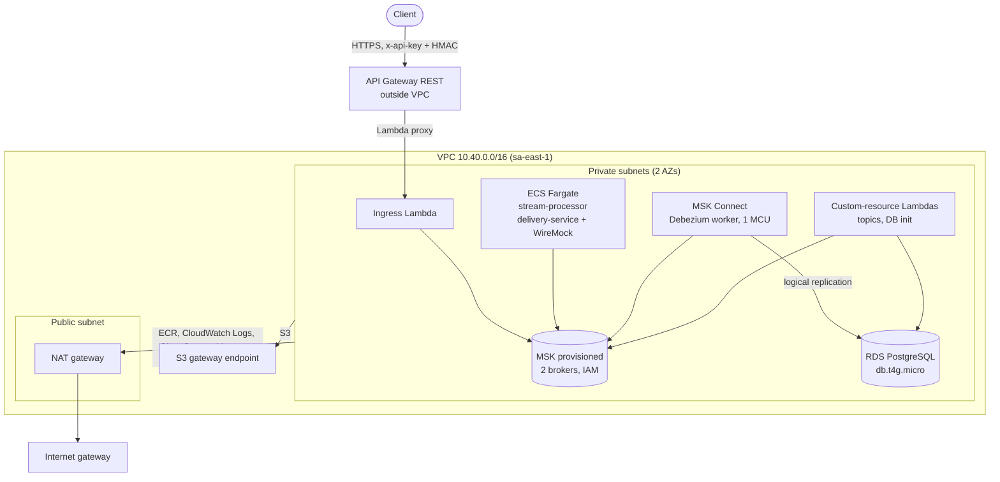

# Architecture

Status: M1–M3 implemented and tested locally; M4 (AWS) templates in progress. Remaining `TODO` markers are cleaned up in M5.

## Components

### ingress-lambda

**How it works.** Exposed through API Gateway REST `POST /events`. Validates the payload, optionally verifies an HMAC signature (`INGRESS_HMAC_SECRET`), and produces to `sf.change-events.raw` with an idempotent Kafka producer. Returns `202` only after the broker acknowledges the write, and `503` if the broker call fails.

**What can go wrong.**
- Broker unavailable or slow: the caller gets `503` and must retry. Nothing is acknowledged that was not written.
- Client retries after a timeout: the same event can be sent twice. The idempotent producer prevents duplicates from producer retries within one session, but not from client-level retries. Downstream deduplication is by event id.
- HMAC secret misconfigured or absent: requests are rejected (if HMAC is enabled) or accepted without authentication (if it is not). Enable it in any shared environment.

### PostgreSQL and Debezium

**How it works.** The `orders` table is read through logical replication (`pgoutput`) by the Debezium PostgreSQL connector (`orders-source`), running on Kafka Connect locally and on MSK Connect in AWS. Changes are published to `erp.public.orders` as Avro.

**What can go wrong.**
- Connector stops: the replication slot keeps retaining WAL and disk on the database grows. See [connector restart and slot lag](runbooks/connector-restart-and-slot-lag.md).
- Slot dropped: changes not yet consumed are lost from the CDC stream, and the connector must re-snapshot.
- Schema change on `orders` without a matching schema change in `schemas/order/`: events fail to serialize or consumers fail to read. See [schema evolution](runbooks/schema-evolution.md).

### stream-processor (Kafka Streams)

**How it works.** Runs with `processing.guarantee=exactly_once_v2`. Two topologies:
- Topology A: `sf.change-events.raw` to `integration.account.v1` (Avro `AccountEvent`).
- Topology B: `erp.public.orders` to `integration.order.v1` (Avro `OrderEvent`).

Records that cannot be transformed are routed to `integration.dlq` with the error headers described below.

**What can go wrong.**
- Poison message: a record that always fails is routed to the DLQ, not retried forever. Verify that deserialization errors are caught per record. `TODO (M2)`: confirm the error-handling wiring.
- Rebalance or restart: processing resumes from the last committed transaction. Records may be reprocessed, but transactional output is not duplicated within Kafka.
- Schema mismatch with the registry: serialization fails. Check compatibility before deploying a producer change.
- Scaling beyond partition count: extra tasks sit idle. Partition count is set in the topics stack.

### delivery-service

**How it works.** Consumes `integration.account.v1` and `integration.order.v1` with manual commits (at-least-once). Each event is POSTed to the downstream HTTP service with `Idempotency-Key` set to the event id.
- `4xx` (except `429`): sent to `integration.dlq`.
- `5xx`, `429`, or timeout: sent to `integration.retry.1m`, then `integration.retry.10m`, then `integration.dlq`.

**What can go wrong.**
- Crash after the HTTP call but before the commit: the event is delivered again. The downstream service must honor `Idempotency-Key`.
- Retry topics reorder events: a retried event for a key can be processed after later events for the same key. See [ordering](#ordering-per-key-and-partitions).
- Downstream outage: events move through retry hops and can reach the DLQ. Replay them after recovery with replay-cli.
- Downstream ignores `Idempotency-Key`: duplicate side effects are possible. This is a contract with the downstream service, not something this platform can enforce.

### replay-cli

**How it works.** Reads messages from `integration.dlq` and republishes them to the source topic (from the `source-topic` header). Supports rate limiting, filters, and `--dry-run`. Adds a `replayed-at` header to each republished record.

**What can go wrong.**
- Replaying without fixing the cause: the message fails again and returns to the DLQ.
- Replaying into a stream that has moved on: the event may now be stale. Filter by `failed-at` where needed.
- Without `--dry-run`, a wrong filter republishes a large set. Always dry-run first.
- `TODO (M2)`: confirm how replayed messages keep their original key and partition routing.

### observability

`TODO (M4)`: metrics, dashboards, and alarms (consumer lag, DLQ depth, connector status, replication slot lag). Local equivalent: Kafka UI on port `8090`.

## Ordering per key and partitions

- Kafka guarantees order only within a partition. Records with the same key go to the same partition, so they are ordered relative to each other on the source topic.
- Keys: the raw topic uses the first Salesforce record id from `ChangeEventHeader.recordIds`. CDC uses the `orders` primary key. Canonical topics use the account id or order id.
- Topology A and B preserve per-key order as long as they do not reroute records.
- Delivery retries break per-key order. A retried event is republished to a retry topic and processed after events that arrived later. Downstream must tolerate out-of-order arrival (for example, by comparing a version or timestamp).
- The DLQ is not ordered with respect to the main flow, and replay does not restore original order.

## Delivery semantics

| Stage | Guarantee | Notes |
|---|---|---|
| ingress to raw topic | At least once from the client's view; no duplicates from producer retries within a session (idempotent producer) | Client retries can still duplicate. Deduplicate downstream by event id. |
| Kafka Streams read-process-write | Exactly once (`exactly_once_v2`) | Scope is Kafka only: reads, state, and writes to Kafka topics within one transaction. |
| stream-processor to canonical topics | Exactly once within Kafka | Does not cover the downstream HTTP call. |
| delivery-service to downstream HTTP | At least once | Manual commit after the HTTP outcome. Duplicates possible. |

**`exactly_once_v2` does not cover external HTTP calls.** A delivery is an external side effect. If the process crashes after the HTTP call succeeds and before the offset is committed, the event is sent again. The `Idempotency-Key` (event id) header is the mechanism that lets the downstream service suppress the duplicate.

## DLQ header contract

Every record written to `integration.dlq` carries these headers:

| Header | Meaning |
|---|---|
| `error-class` | Exception class name that caused the failure |
| `error-message` | Exception message (truncated to 1000 characters) |
| `source-topic` | Topic the record was read from; replay returns it here |
| `source-partition` | Partition of the source record |
| `source-offset` | Offset of the source record |
| `failed-at` | ISO-8601 UTC timestamp of the failure |
| `attempts` | Number of delivery or processing attempts made |

Added by replay-cli on republish:

| Header | Meaning |
|---|---|
| `replayed-at` | ISO-8601 UTC timestamp of the replay |

`TODO (M2)`: confirm the value formats and whether `attempts` is carried through the retry topics.

## AWS deployment

Design contract: [infra/cloudformation/CONTRACT.md](../infra/cloudformation/CONTRACT.md). Default region sa-east-1. Cost and teardown rules: [cost.md](cost.md).

### Stacks, in deploy order

0. `budget`: AWS Budget, monthly limit $20 (account-level, deployed first).
0. `github-oidc`: GitHub OIDC provider and deploy role (optional, once).
1. `artifacts`: S3 bucket for Lambda jars and the Connect plugin zip.
2. `network`: VPC 10.40.0.0/16, 2 private subnets, 1 public subnet, one NAT gateway, S3 gateway endpoint, security groups.
3. `msk`: MSK provisioned (2 × `kafka.t3.small`) or serverless, IAM auth, TLS in transit, custom configuration.
4. `topics`: topics from `scripts/topics.txt`, created by the infra-bootstrap `TopicsHandler` Lambda.
5. `schema-registry`: Glue Schema Registry `${EnvName}-msk-ei`, schemas registered by script.
6. `database`: RDS PostgreSQL 16 `db.t4g.micro`, single-AZ, logical replication on, schema created by `DbInitHandler`.
7. `ecr`: image repositories for stream-processor, delivery-service, downstream-mock.
8. `msk-connect`: Debezium PostgreSQL connector on 1 MCU, Glue value converter.
9. `ingress`: API Gateway `POST /events` (API key, usage plan), ingress Lambda in the private subnets, HMAC secret, alarms.
10. `processing`: ECS cluster, Fargate services stream-processor and delivery-service (with WireMock sidecar), no public IPs.
11. `observability`: CloudWatch dashboard, DLQ and consumer-lag alarms, SNS topic with email subscription.

Teardown runs in reverse order, empties the artifacts bucket, and deletes the Glue schemas before their stacks.

### Network

Notes: the API Gateway is a regional service outside the VPC and invokes the ingress Lambda through the Lambda service. MSK, RDS and the Lambdas have no public addresses. Fargate tasks have no public IPs.

### Glue Schema Registry

- Registry `${EnvName}-msk-ei`. Schema names equal topic names (`integration.account.v1`, `integration.order.v1`, `erp.public.orders`). Compatibility `BACKWARD`, format `AVRO`.
- Ingress publishes raw JSON with no registry. Services and Debezium use the Glue serializer and the Glue Kafka Connect converter.
- Glue wire format differs from Confluent. The registry is chosen per deployment (ADR 0002).
- Glue Schema Registry usage is free (AWS Glue pricing page).

### Local versus AWS configuration

| Setting | Local | AWS |
|---|---|---|
| Kafka bootstrap | `localhost:9092` | `BootstrapServers` (IAM listener, port 9098) |
| Kafka security | plaintext | `KAFKA_SECURITY=iam` |
| Schema registry | Confluent (`SCHEMA_REGISTRY_URL`) | Glue (`SCHEMA_REGISTRY_TYPE=glue`, `GLUE_REGISTRY_NAME`) |
| Schema auto-register | `true` | `false` (registered by script) |
| HMAC secret | `INGRESS_HMAC_SECRET` | `INGRESS_HMAC_SECRET_ARN` (Secrets Manager) |
| Downstream | local WireMock | `DOWNSTREAM_URL=http://localhost:8080/downstream` (sidecar) |
| Debezium DB password | `.env` | dynamic reference to the RDS secret |
